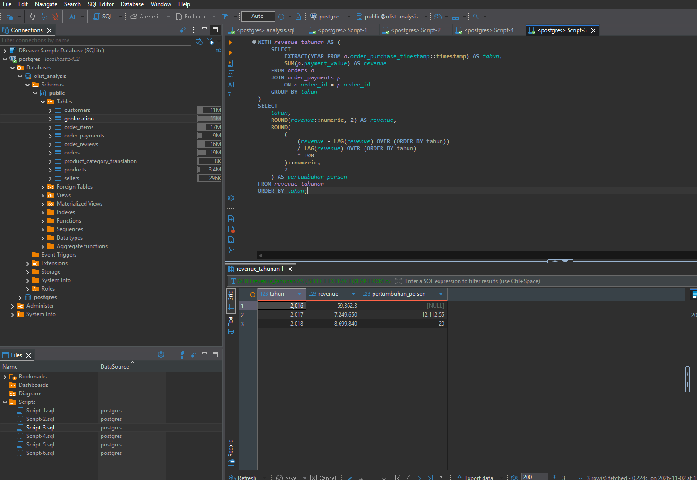
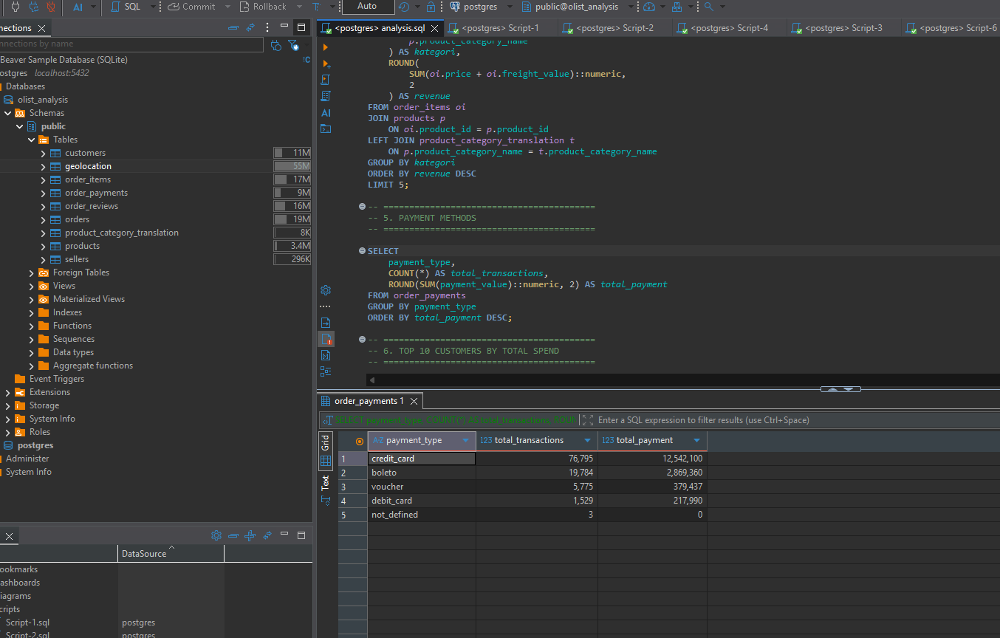
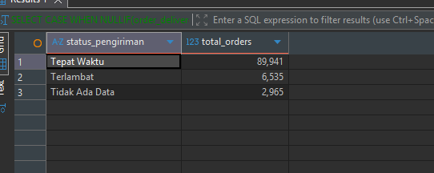
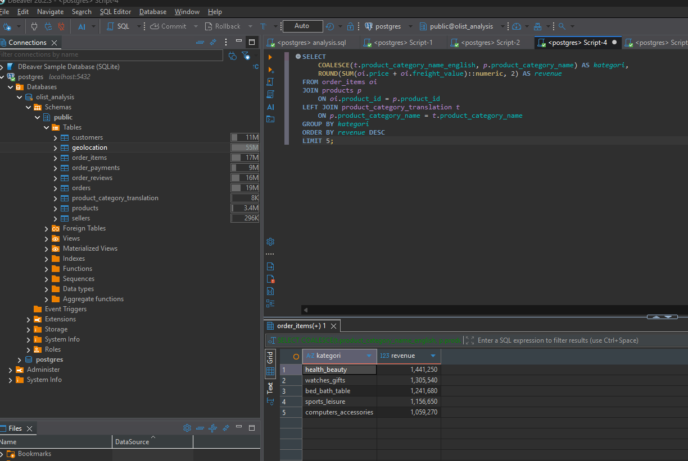

# Olist Brazilian E-Commerce Data Analysis

## 📌 Project Overview

This project analyzes the Olist Brazilian E-Commerce Public Dataset using SQL and PostgreSQL.

The analysis focuses on business performance, customer behavior, product performance, payment methods, delivery performance, seller performance, and revenue growth.

## 🎯 Objectives

- Analyze overall e-commerce revenue and orders
- Calculate Average Order Value (AOV)
- Identify top-performing product categories
- Analyze customer payment preferences
- Analyze customer spending behavior
- Evaluate customer ratings
- Analyze delivery performance
- Identify top-performing sellers
- Analyze yearly revenue growth

## 🛠️ Tools

- PostgreSQL
- DBeaver
- SQL
- Olist Brazilian E-Commerce Public Dataset

## 📊 Analysis

The project includes the following SQL analyses:

1. Total Revenue
2. Total Orders & Average Order Value
3. Monthly Revenue
4. Top 5 Product Categories by Revenue
5. Payment Methods
6. Top 10 Customers by Total Spend
7. Average Rating by Product Category
8. Delivery Performance
9. Average Delivery Time
10. Delivery Status vs Customer Rating
11. Top 10 Sellers by Revenue
12. Top 10 Sellers by Number of Orders
13. Yearly Revenue Growth

## 🔍 Key Findings

## 📈 Revenue Growth

The analysis shows that revenue increased year over year, with revenue growth reaching approximately 12% in 2017 and 20% in 2018.


## 💳 Payment Methods

Credit card is the dominant payment method by both transaction volume and total payment value.



## 🚚 Delivery Performance

The analysis compares orders delivered on time with delayed orders.



## 🛍️ Top Product Categories

The analysis identifies the top 5 product categories based on total revenue.



## 💡 Business Insights

- Revenue showed positive year-over-year growth, increasing by approximately 12% in 2017 and 20% in 2018.
- Credit card was the dominant payment method in both transaction volume and total payment value.
- Delivery performance was analyzed to identify on-time and delayed orders and its potential relationship with customer ratings.
- Health & Beauty was the highest-revenue product category among the analyzed categories.
- Seller analysis helped identify high-performing sellers based on revenue and order volume.

## 📁 Project Structure

```text
Olist-SQL-Data-Analysis/
├── analysis.sql
├── README.md
├── revenue_growth.png
├── payment_methods.png
├── delivery_performance.png
└── top_product_categories.png
The dataset contains information about orders, customers, sellers, products, payments, reviews, and delivery.

👤 Author
Seychar Ramadhan
Data Analyst Portfolio Project

🛠️ Tools
- PostgreSQL
- DBeaver
- SQL
- GitHub

📌 Conclusion
This project demonstrates the use of SQL to analyze e-commerce data and generate business insights related to revenue, customers, payments, products, sellers, reviews, and delivery performance.
